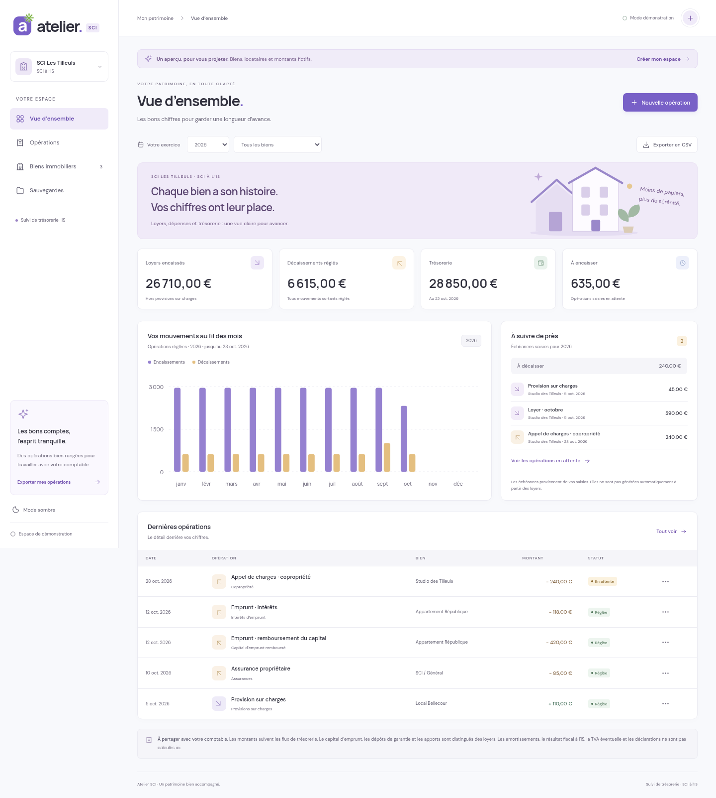
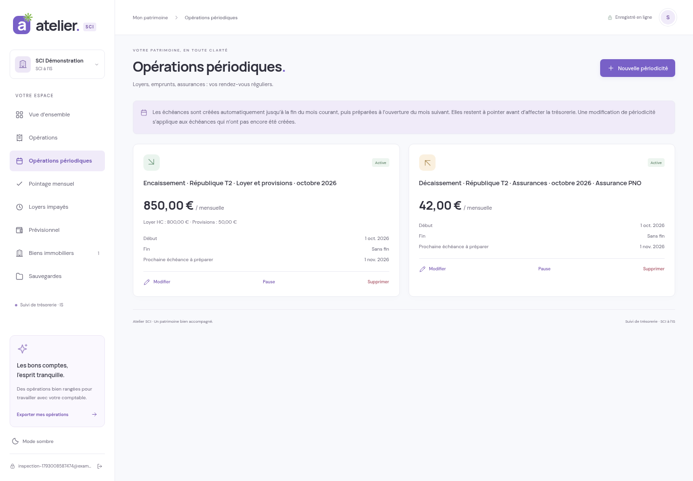
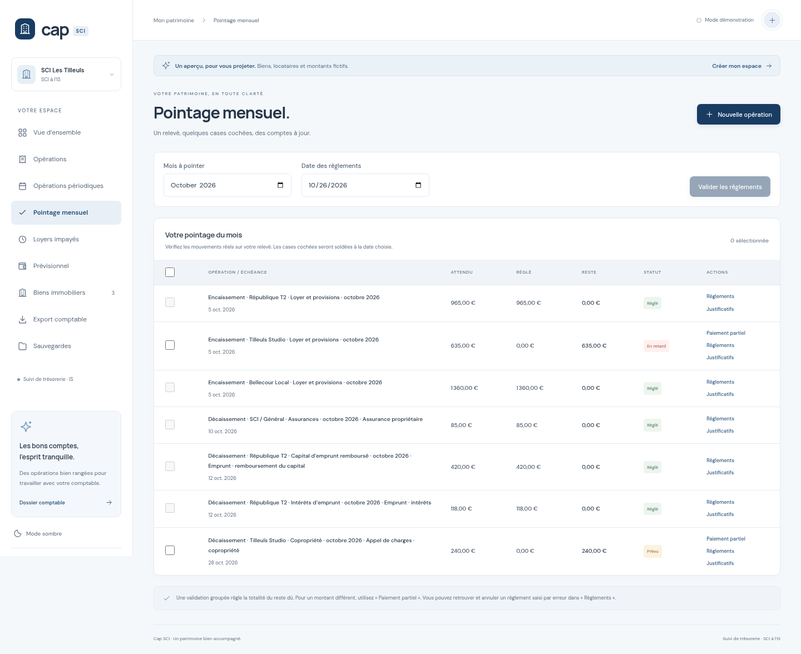
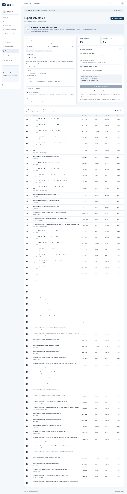

# Cap SCI

Cap SCI est le nouveau nom d’Atelier SCI. Le changement de nom et de couleurs conserve vos comptes, données, réglages et anciennes sauvegardes.

Un site en français pour suivre les biens, les loyers et la trésorerie d’une **SCI à l’IS**, avec un compte personnel et des données conservées dans une base SQLite côté serveur.



## Le parcours conseillé

Le menu principal rassemble **Vue d’ensemble, Pointage mensuel, Opérations, Biens immobiliers et Export comptable**. Les fiches et périodicités sont regroupées dans **Dossiers** ; les accès, sauvegardes, historique, documents et contrôles sont dans **Outils et réglages**. Le bouton **Aide** propose des étapes et bonnes pratiques adaptées à la page ; une aide est aussi accessible dans les formulaires, sans abandonner la saisie.

1. Réglez le nom de la SCI, la date et le montant du solde bancaire initial dans les paramètres.
2. Pour les loyers, créez le bien, le locataire, puis la location et joignez le bail.
3. Depuis la location, préparez le loyer périodique. Si une périodicité existe déjà, elle est ouverte plutôt que doublée.
4. Pointez uniquement les mouvements réellement constatés sur le relevé, avec leur date réelle et leurs justificatifs.
5. Comparez le solde bancaire en fin de pointage, puis préparez le dossier à transmettre au comptable.

### Changer un loyer et corriger une erreur

La location conserve le contrat initial et les changements de loyer datés. Utilisez **Modifier le loyer** dans son dossier, avec une date d’effet. Les prochaines échéances et prévisions utilisent les montants correspondant à leur date. Les échéances déjà réglées, même partiellement, restent conservées ; un compte rendu indique celles qui ne sont pas modifiées. La fiche du bien affiche le montant du contrat en cours au lieu d’en demander une deuxième saisie. Les références de facture se renseignent sur chaque opération et non sur le modèle périodique.

Une opération réglée se corrige par **Annuler l’opération**, avec un motif. Elle est retirée des soldes et exports courants mais garde ses paiements d’origine et sa trace dans l’historique. Créez ensuite la bonne opération si nécessaire. Une opération prévue non réglée peut être supprimée, avec une trace. Les annulations sont consultables par le filtre « Annulées » et peuvent être incluses explicitement dans l’export.

Une location créée par erreur peut être supprimée par le propriétaire uniquement si elle est réellement vide : aucun document, règlement/opération, périodicité ou changement de loyer. Le serveur vérifie ces conditions au moment de la suppression.

### Utiliser la même SCI à deux

Dans **Outils et réglages → Accès et mot de passe**, le propriétaire crée une invitation liée à l’e-mail de la deuxième personne et lui transmet le lien affiché. Aucun message n’est envoyé automatiquement. Le lien est valable sept jours et ne peut être accepté qu’une fois, avec l’adresse prévue. La personne crée son identifiant ou se connecte à un compte vide, puis confirme **Rejoindre la SCI**. Les deux personnes partagent alors les mêmes données, avec leur propre mot de passe. Les invitations ne fusionnent pas deux espaces déjà remplis.

Deux accès maximum sont prévus. Le propriétaire peut retirer le deuxième accès, ce qui invalide ses sessions. En production, le premier compte reste créable ; les inscriptions suivantes nécessitent une invitation par défaut (`SCI_REGISTRATION_MODE=closed`). Le mode de développement reste ouvert pour les essais.

### Préparer l’année du comptable

Dans l’export, **Dossier annuel comptable** retient les opérations dont l’échéance ou la période concerne l’année, ainsi que les règlements de l’année. Cela inclut les factures non réglées et les règlements de dettes antérieures. Les annulations restent exclues par défaut. Vérifiez la sélection et les pièces avec le comptable : il s’agit d’un dossier de préparation, pas d’un FEC ou d’une déclaration fiscale.

### Sauvegardes et documents

Le service Compose `backup` crée automatiquement une sauvegarde SQLite complète et vérifiée au démarrage puis toutes les 24 heures ; il conserve les 30 dernières copies par défaut. L’intervalle et la rétention se règlent dans `.env`. Le volume `sci_backups` est séparé de la base active, mais reste **sur la même machine**. Prévoyez une copie régulière sur un autre support ; cette configuration ne transfère pas automatiquement les fichiers vers un autre ordinateur ou un cloud. Pour vérifier le service : `docker compose logs --tail=30 backup`.

**Historique des corrections** permet de retrouver auteur, date et changements. Une restauration JSON explicite accepte les anciennes données lisibles et conserve un instantané de l’état précédent (les dix derniers sont téléchargeables depuis l’historique). Le JSON et ces instantanés n’incluent pas les fichiers. Les sauvegardes SQLite complètes contiennent comptes, accès, opérations et documents.

**Espace documentaire** indique les fichiers utilisés et le quota commun. Le propriétaire peut nettoyer individuellement les documents devenus sans fiche ou opération après suppression/import. Sauvegardez ou téléchargez les pièces utiles avant de confirmer leur suppression définitive. Les documents d’une fiche désactivée ne sont pas considérés comme orphelins.

## Essayer sous Windows

Installez **Node.js 24 LTS ou plus récent**. Téléchargez le ZIP du dépôt, décompressez-le et ouvrez PowerShell dans le dossier qui contient `package.json`.

```powershell
npm.cmd ci
npm.cmd run dev
```

Ouvrez l’adresse indiquée par Vite dans le terminal (port 5173 par défaut). Gardez le terminal ouvert. **Ctrl + C** arrête les deux serveurs.

Le mode démonstration présente des biens, locataires et montants **fictifs**. Cliquez sur **Créer mon espace** pour créer votre propre compte : votre SCI démarre vide, au régime IS. Aucun e-mail de validation n’est envoyé. Choisissez un mot de passe d’au moins 12 caractères. La modification est accessible dans les accès ; une récupération administrateur est prévue en cas d’oubli.

`npm.cmd run dev` lance à la fois l’API Node.js (port 3001) et Vite (port 5173). Le serveur doit rester actif pour enregistrer les données. L’ancienne clé de stockage de l’application de tâches Atelier n’est pas modifiée.

## Ce qui fonctionne

- Tableau de bord annuel : loyers encaissés hors provisions, décaissements réglés, trésorerie et montants à encaisser.
- Graphique mensuel des mouvements réglés, filtres par année et par bien.
- Création et modification des biens, loyers de référence, provisions, locataires et archivage sans suppression de l’historique.
- Journal avec saisie, modification et suppression confirmée des opérations ; recherche, catégories, filtres et pagination.
- Distinction entre loyers, provisions, apports, emprunts, intérêts, capital remboursé et dépôts de garantie.
- Échéances en attente, enregistrées comme réglées à la **date effective du règlement**, avec conservation de l’échéance initiale dans l’export.
- Export CSV compatible Excel ; sauvegarde et restauration JSON avec validation et confirmation.
- Deux accès personnels possibles à la même SCI, et connexion depuis plusieurs navigateurs. Les données sont rechargées au retour sur l’onglet ou au rechargement de la page. Les conflits d’édition sont signalés et ne remplacent pas les changements d’un autre appareil.
- Mode sombre et interface pour téléphone.

Les montants de la fiche du bien servent de référence. Configurez ensuite une **opération périodique** pour préparer les échéances : la seule création d’un bien ne suffit pas. Les quittances ne sont pas générées. Les opérations prévues et les règlements datés après la date d’arrêté ne gonflent pas la trésorerie.



## Fournisseurs, locataires et locations

**Fournisseurs** centralise nom court, raison sociale, coordonnées, SIRET, catégorie habituelle et référence client/contrat. Choisissez une fiche dans une opération ou une périodicité ; vous pouvez aussi créer un fournisseur pendant la saisie. La référence de chaque facture reste propre à l’opération. Désactiver une fiche conserve son historique et ses documents.

**Locataires** conserve les coordonnées et documents personnels. **Locations** relie un locataire à un bien, avec dates d’entrée/sortie, loyer, provisions, dépôt prévu et jour d’échéance. Une location correspond à une occupation ; cette version accepte une seule location à la fois par bien. Pour un couple ou une colocation avec bail commun, renseignez les noms sur la même fiche. Créez une nouvelle location lors du changement d’occupant. Les noms historiques déjà saisis sur les biens ne deviennent pas automatiquement des fiches : créez-les et rattachez les opérations concernées explicitement.

Depuis une location, **Préparer le loyer périodique** propose les données du bail. Les nouvelles échéances sont bornées par les dates d’occupation. Terminer une location conserve les opérations déjà créées : vérifiez les échéances en attente et ajustez manuellement le dernier loyer si un prorata est nécessaire. Le dépôt de garantie renseigné sur la location est un montant prévu ; son encaissement et sa restitution se saisissent comme opérations.

Les fiches affichent les opérations rattachées par sélection explicite ; un même nom en texte libre ne crée pas de lien. Les changements de coordonnées ne réécrivent pas le nom du tiers conservé sur les anciennes opérations.

Les documents sont accessibles depuis les fiches : contrats sur le fournisseur, documents personnels sur le locataire, baux/avenants/états des lieux/assurances sur la location. Le dépôt accepte plusieurs PDF, JPEG ou PNG à la fois et indique les fichiers refusés. Le quota de 50 Mo par compte couvre tous les documents et justificatifs. Dans l’export comptable, **Inclure les baux et avenants** est une option volontaire, limitée aux locations des opérations retenues ; les documents personnels restent exclus. Les nouvelles fiches et contrôles sont conservés dans le JSON, les fichiers restent dans la sauvegarde complète du serveur.

## Liens et saisie assistée

Les champs Bien, Fournisseur, Locataire et Location proposent une seule liste par information ; tapez les premières lettres au clavier pour retrouver une fiche. Choisir un résultat enregistre l’identifiant de la fiche, pas seulement son nom. Un rattachement correspond toujours à une fiche choisie dans la liste. Vous pouvez créer un fournisseur ou un locataire pendant la saisie d’une opération ou périodicité.

Choisir un bien pour un loyer propose sa location à la date de l’opération lorsqu’elle est unique. Choisir un locataire retrouve sa location si elle est unique pour le bien et la date ; sinon, choisissez la location explicitement. Celle-ci complète bien, locataire, loyer et provisions. Un fournisseur propose sa catégorie et, si un seul bien lui est explicitement rattaché, ce bien.

Dans **Biens immobiliers → Modifier**, cochez les fournisseurs habituels du bien. **Dossier du bien** rassemble ses locations, les fournisseurs explicitement rattachés ou présents dans ses mouvements et un accès aux opérations. Les fiches fournisseurs affichent les biens associés ; le journal permet d’ouvrir les fiches liées. Pour rattacher un locataire au bien, créez une location datée depuis son dossier, afin de conserver l’historique. Ces liens sont conservés dans la base SQLite et les sauvegardes JSON. Une simple égalité de noms ne rattache pas automatiquement les anciennes saisies.

## Vérifier les saisies

Les formulaires d’opérations et périodicités n’affichent qu’un choix de tiers : **Location et locataire** pour les loyers/provisions/dépôts de garantie, **Fournisseur / banque** pour les dépenses et prêts, ou **Personne / organisme** pour les apports et autres encaissements. Le nom du tiers et les identifiants déduits du choix sont enregistrés sans être redemandés. Une location sélectionnée fournit déjà le bien : ce champ est alors masqué.

Les champs nécessaires bloquent l’enregistrement : montant total positif, dates valides, type et catégorie cohérents ; fournisseur enregistré pour une dépense ; location, bien et locataire pour un mouvement locatif ; tiers identifié pour un apport. Les biens demandent un nom unique et une adresse ; une location demande des dates cohérentes, un loyer positif et des montants de charges/dépôt non négatifs. Les fiches contacts demandent un nom, contrôlent les coordonnées et vérifient le format du SIRET lorsqu’il est renseigné. Ces contrôles vérifient la cohérence des données ; ils ne certifient pas les pièces ou les déclarations fiscales.

Le serveur contrôle les nouvelles opérations, périodicités et informations essentielles modifiées. Les données historiques déjà enregistrées restent lisibles et les pointages peuvent continuer ; une ancienne fiche incomplète se complète lors de son édition.

## Gagner du temps chaque mois

- Filtrez le pointage par bien, sens et reste à pointer ; changer un filtre remet la sélection de règlements à zéro.
- Filtrez le journal par justificatif manquant, présent ou non nécessaire. Une lecture des documents indisponible ne doit pas être interprétée comme une absence de pièce.
- Cochez **Justificatif non nécessaire** pour les mouvements pour lesquels vous n’attendez pas de document.
- **Dupliquer** reprend les informations d’une opération avec une nouvelle date et sans règlement, référence de facture ou fichier. Vérifiez les montants et la location avant d’enregistrer.
- Une opération semblable déclenche un avertissement de doublon ; un deuxième enregistrement permet de confirmer une répétition légitime.
- Fermer un formulaire modifié demande de confirmer l’abandon. Les clics à côté ne ferment toujours pas les fenêtres.
- L’export propose le mois et le trimestre précédents, conserve les préférences par compte sur ce navigateur et affiche les pièces/références à vérifier avant téléchargement.

**Contrôle bancaire** permet de saisir le solde de fin de journée du relevé à une date, puis d’observer l’écart avec les mouvements réglés de l’application. Ce contrôle vise un seul compte bancaire suivi ; il ne se connecte pas à la banque. Les écarts sont recalculés lorsque les opérations sont corrigées. Un écart nul ne garantit pas l’absence de deux erreurs qui se compensent.

## Organiser les opérations régulières

1. Donnez un **nom court unique** à chaque bien, par exemple « République T2 ». L’adresse reste dans la fiche. Les anciens noms sont conservés ; renommez les éventuels doublons avant de créer de nouvelles fiches.
2. Ouvrez **Opérations périodiques → Nouvelle périodicité** : choisissez le type, le bien, la catégorie, la fréquence mensuelle/trimestrielle/annuelle et les dates de début et de fin. Le jour du début est conservé ; le 31 tombe au dernier jour des mois plus courts, sans décaler les mois suivants.
3. Pour un loyer lié à une location, les montants hors charges et provisions viennent du contrat et de ses changements datés. Une seule échéance et un seul paiement peuvent couvrir les deux. Les nouveaux libellés sont proposés automatiquement : **Type · Nom court · Catégorie · Période**, avec un détail libre facultatif. La période concernée reste distincte de la date réelle du paiement.
4. Les échéances sont préparées jusqu’à la fin du mois courant lors de l’ouverture/actualisation du compte, et après l’enregistrement d’une périodicité. Les mois manqués sont rattrapés depuis le début choisi. Aucun paiement n’est présumé effectué ; il n’y a ni connexion bancaire ni service payant ajouté.
5. Dans **Pointage mensuel**, comparez les lignes à votre relevé, cochez les règlements réellement constatés et choisissez leur date. Une confirmation précède la validation groupée. Les lignes non cochées restent prévues ou en retard.
6. Pour un **paiement partiel**, indiquez le montant reçu. La ventilation loyer/provisions est proposée proportionnellement en centimes, et vous pouvez la modifier. Plusieurs règlements peuvent solder la même échéance. « Règlements » affiche leurs dates et permet d’annuler une erreur.
7. **Loyers impayés** retrouve les loyers et provisions échus non soldés, paiements partiels compris. **Prévisionnel** projette les 12 mois à venir à partir du solde réel et des opérations prévues, sans compter deux fois les échéances déjà créées. Les impayés échus sont affichés séparément : leur encaissement n’est pas supposé certain.

Mettre une périodicité en pause ou la supprimer conserve toutes les échéances déjà créées et leurs règlements. La reprise repart d’aujourd’hui, sans recréer les mois suspendus. Pour les loyers liés à une location, utilisez le changement daté du loyer afin de traiter aussi les échéances non réglées déjà préparées. Pour les autres périodicités, modifier le modèle s’applique aux échéances non encore créées. Archiver un bien met ses périodicités en pause.

Pour un **prêt**, choisissez la catégorie **Échéance de prêt** dans une opération ou une périodicité. Renseignez **Capital remboursé**, **Intérêts** et **Assurance emprunteur** : leur somme donne le montant total, sans créer trois prélèvements. L’assurance peut rester à zéro si elle est prélevée séparément ; saisissez alors une opération distincte pour éviter de la compter deux fois. Les anciennes catégories « Capital d’emprunt remboursé » et « Intérêts d’emprunt » restent disponibles.

Dans **Pointage mensuel → Ajuster le prêt**, reportez chaque mois les montants du tableau d’amortissement bancaire avant de pointer le règlement. L’ajustement ne change que l’échéance choisie, sans toucher à la périodicité ni aux autres mois. Après un règlement, la répartition peut être corrigée à **total inchangé** ; pour corriger le montant payé, annulez d’abord les règlements concernés. L’application ne reconstruit pas automatiquement le tableau bancaire.

Les opérations et périodicités proposent aussi **Fournisseur / bénéficiaire / locataire**, **Référence de facture** et **Note pour le comptable**. Les informations d’une périodicité sont reprises sur ses nouvelles échéances ; vérifiez les références propres à chaque mois. Elles figurent dans les CSV. La ventilation du prêt y est indiquée comme **montants attendus pour l’échéance entière**, distincts des règlements réels, notamment en cas de paiement partiel.

Les fenêtres restent ouvertes lorsqu’on clique à côté. **Fermer**, **Annuler** et Échap demandent de confirmer l’abandon si la saisie a été modifiée.



## Joindre des justificatifs

Dans le menu d’une opération ou depuis le pointage, ouvrez **Justificatifs** pour ajouter et télécharger des PDF, JPEG ou PNG. Limites : **5 Mo par fichier, 20 fichiers par opération, 50 Mo par compte**. L’accès nécessite le compte propriétaire. Les fichiers sont stockés dans la base SQLite, sans être publiés dans les fichiers du site.

Le journal et le pointage affichent **Justificatif manquant** lorsqu’aucune pièce n’est jointe, puis le nombre de documents après ajout. Cet indicateur signale l’absence de pièce ; il ne détermine pas si une pièce est obligatoire ni si son contenu est correct. Le CSV comptable reprend le nombre de pièces et leur absence éventuelle, même si vous choisissez de ne pas inclure les documents dans le ZIP.

À l’enregistrement, le document est automatiquement nommé d’après le **libellé de l’opération**. Son extension est conservée et un numéro distingue plusieurs pièces (`… (2).pdf`). Les caractères interdits dans les noms Windows sont remplacés et les libellés très longs sont raccourcis pour le nom du fichier. Le libellé complet reste dans le dossier comptable. Le nom original est conservé comme référence ; les octets du fichier ne sont pas modifiés. Les pièces existantes sont également mises au même format, et un changement de libellé actualise leurs noms.

**L’export JSON contient les opérations, les périodicités et les règlements, mais pas les fichiers justificatifs.** Utilisez le dossier comptable ZIP pour transmettre les pièces sélectionnées, téléchargez-les séparément ou sauvegardez toute la base serveur avec le script fourni. Lorsqu’une opération est supprimée/remplacée par un import, ses anciens fichiers restent conservés dans la base mais ne sont plus accessibles tant que l’opération correspondante n’est pas restaurée ; cette rétention compte dans le quota.

## Mettre à jour sans perdre votre SCI sous Windows

1. Faites un export JSON, puis arrêtez l’application avec **Ctrl+C**.
2. Copiez **tout le dossier `data`** dans un emplacement de sauvegarde privé, une fois le serveur arrêté. Ce dossier contient les comptes, les opérations et les fichiers justificatifs.
3. Téléchargez et décompressez la nouvelle version. Replacez une copie de votre dossier `data` dans le nouveau dossier du projet, avant le premier lancement. Ne remplacez jamais votre base existante par une base vide.
4. Lancez `npm.cmd ci`, puis `npm.cmd run dev`. Retrouvez votre compte habituel. Les anciennes sauvegardes JSON version 1 restent lisibles ; les anciens libellés sont conservés jusqu’à leur modification.

## Ce que signifient les chiffres

Les calculs utilisent des **centimes entiers**. La trésorerie globale correspond au solde initial plus les encaissements réglés moins les décaissements réglés, de la date initiale jusqu’à la date d’arrêté. La date d’arrêté est aujourd’hui pour l’exercice courant, ou le 31 décembre pour un exercice passé. Pour un bien isolé, l’indicateur affiche le solde de ses mouvements de l’année : le solde bancaire initial n’est pas réparti arbitrairement entre les biens.

L’application prépare un **suivi de trésorerie à partager avec le comptable**. Elle ne produit pas la comptabilité en partie double, les amortissements, la TVA, le bilan, le résultat fiscal à l’IS, les déclarations ou un FEC. Un remboursement de capital ou une restitution de dépôt reste un mouvement de trésorerie, sans être présenté comme une charge fiscale déductible.

## Préparer le dossier du comptable

Ouvrez **Export comptable** dans le menu. Cet écran permet de choisir précisément ce qui sera transmis :

1. Indiquez **Du / Au** : les deux dates sont incluses. Les raccourcis permettent de choisir l’année en cours, l’année précédente ou le mois courant.
2. Choisissez **Dates à utiliser** :
   - **Règlements réels** : seules les opérations ayant un règlement dans la plage sont retenues. Par défaut, seuls ces règlements sont détaillés dans le dossier.
   - **Échéances des opérations** : les opérations sont retenues selon leur échéance. Cela permet notamment de transmettre les sommes non encore réglées ; tous leurs règlements liés sont fournis, avec leur position dans/hors plage.
   - **Période concernée (mois)** : les mois de début et de fin sont inclus entièrement, même si le jour choisi n’est pas le premier/dernier du mois. Les règlements liés restent distincts de la période de loyer.
3. Filtrez les types, statuts, biens et catégories, ou recherchez un libellé, un tiers ou une référence. Aucune case cochée dans un groupe de filtres signifie « tous ».
4. Dans l’aperçu, décochez les opérations à ne pas transmettre. **Tout inclure** permet de sélectionner/désélectionner l’ensemble. Modifier un filtre réinitialise cette sélection ; les compteurs et totaux sont actualisés avant téléchargement.
5. Laissez **Inclure les justificatifs** coché pour joindre les documents des opérations retenues. L’option **Inclure tous les règlements liés**, en mode règlements réels, ajoute volontairement leur historique hors dates. Ces règlements sont repérés et ne gonflent pas les totaux de la plage.
6. Téléchargez le **dossier ZIP**. Le compte doit être connecté et les modifications enregistrées. En démonstration, un CSV des opérations permet d’essayer les filtres.

Le ZIP comprend :

- `operations.csv` : libellés, dates, périodes, biens, locataires, catégories, montants attendus, ventilation loyer/provisions, totaux réglés historiques, restes dus, règlements de la plage, références et notes.
- `reglements.csv` : un règlement par ligne avec sa date réelle, son montant, sa ventilation, l’opération liée et l’indicateur dans/hors plage.
- `biens.csv` : noms courts, adresses, locataires et loyers de référence des biens concernés.
- Un dossier par bien, nommé à partir de son nom court, contenant seulement `Encaissements/` et `Décaissements/`. Les justificatifs sont directement rangés dans le dossier correspondant au type de leur opération, en conservant leur libellé comme nom de fichier. Les chemins figurent dans `operations.csv`.
- Les opérations communes sont regroupées dans `SCI - Général/`, avec les mêmes deux dossiers.

Aucun fichier JSON, README ou dossier intermédiaire par opération n’est ajouté au dossier comptable. Les noms sont adaptés à Windows ; un suffixe distingue des biens ou documents qui porteraient le même nom après cette adaptation. Les limites de longueur des chemins peuvent raccourcir les noms de fichiers dans l’archive ; le libellé complet reste dans les CSV.

Exemple :

```text
operations.csv
reglements.csv
biens.csv
République T2/
  Encaissements/
    Encaissement · République T2 · Loyer · novembre 2026.pdf
  Décaissements/
    Décaissement · République T2 · Assurance · novembre 2026.pdf
Tilleuls Studio/
  Encaissements/
  Décaissements/
SCI - Général/
  Encaissements/
  Décaissements/
```

Les dossiers de justificatifs sont ajoutés lorsque « Inclure les justificatifs » est coché. Si cette option et « Inclure les baux et avenants » sont décochées, le ZIP contient seulement les trois CSV. Les baux et avenants demandés sont rangés directement dans le dossier Encaissements du bien, avec un nom qui indique leur nature et la location.

Les CSV sont en UTF-8 avec séparateur point-virgule, lisibles dans Excel. Le total réglé historique d’une opération et son montant attendu ne sont pas des encaissements supplémentaires : les mouvements réels figurent dans `reglements.csv`, et les totaux de plage n’incluent que les paiements de la plage.

**Ce ZIP est un dossier comptable sélectionné, pas une sauvegarde complète restaurable ni un FEC.** Il ne contient ni mots de passe ni sessions. Gardez votre sauvegarde JSON/base complète pour restaurer l’application.



## Accéder depuis plusieurs appareils

Les données d’un compte sont conservées sur **le serveur auquel vous vous connectez**, pas dans le stockage local du navigateur. La base est dans `data/atelier.sqlite` par défaut ; le dossier est exclu de Git et des images Docker.

**Un nom de domaine seul n’héberge pas le site.** Pour un accès permanent depuis votre téléphone et votre ordinateur, il faut aussi un serveur avec un disque persistant, puis faire pointer un sous-domaine vers celui-ci. Un hébergement uniquement statique (par exemple GitHub Pages) ne suffit pas pour l’API et SQLite. Les instructions ci-dessous ne créent ni abonnement, ni serveur, ni enregistrement DNS.

## Mise en ligne sur un VPS avec Docker

Cette configuration publie le site en HTTPS sur les ports 80/443. Pour un accès exclusivement par WireGuard sur un PC Debian, adaptez l’écoute réseau, le pare-feu et le certificat HTTPS à ce réseau privé avant le lancement ; Compose seul ne limite pas l’accès aux deux appareils. Le réveil et l’arrêt automatique du PC se configurent sur son infrastructure, indépendamment de l’application.

Prérequis : un VPS avec Docker et Docker Compose, une sauvegarde du disque, les ports 80 et 443 accessibles, et un sous-domaine pointant vers son adresse IP. Un seul exemplaire du serveur d’application doit utiliser cette base SQLite locale.

1. Récupérez le dépôt sur le VPS et placez-vous dans son dossier.
2. Copiez `.env.example` vers `.env` et remplacez `compta.votre-domaine.fr` par votre sous-domaine.
3. Lancez :

   ```bash
   docker compose up -d --build
   docker compose ps
   docker compose logs --tail=50 app caddy
   ```

4. Ouvrez votre sous-domaine en HTTPS et créez votre compte. Caddy obtient le certificat TLS si le DNS et les ports sont correctement configurés.

La syntaxe de Compose et le démarrage du runtime de production font partie des vérifications. Un essai HTTPS local avec certificat vérifié a aussi validé l’inscription, l’écriture, la sauvegarde et la conservation des données après redémarrage. Le déploiement Compose complet, le DNS et le certificat HTTPS public devront être vérifiés sur l’hébergement choisi avant la saisie de données réelles.

Le volume `sci_data` conserve la base lors des redémarrages et des mises à jour. Le volume `sci_backups` conserve les sauvegardes complètes. **Ne supprimez pas ces volumes** pour mettre à jour le site. Les cookies de production nécessitent HTTPS. Le serveur d’application n’est pas exposé directement au réseau public ; Caddy est le point d’entrée. Les sessions expirent au bout de sept jours.

Le projet utilise des mots de passe hachés avec scrypt, des cookies HttpOnly/SameSite, une limite de tentatives de connexion, des contrôles d’origine des écritures et une vérification de version avant chaque enregistrement. Deux identifiants individuels peuvent partager une SCI grâce à une invitation. L’historique indique l’auteur des modifications. Le propriétaire gère les invitations, les accès, le nettoyage des documents orphelins et les restaurations.

### Sauvegarder le serveur

L’export JSON depuis l’application sauvegarde la SCI connectée. Pour une sauvegarde cohérente de **toute la base et des comptes**, même lorsque SQLite utilise son journal WAL :

```bash
docker compose exec app node scripts/backup.mjs
```

Avec Compose, le fichier est créé dans `/app/backups/`, sur le volume `sci_backups`, commun à l’application et au service de sauvegarde. Copiez-le régulièrement hors du serveur. Copier seulement le fichier SQLite actif sans son journal ne garantit pas une copie à jour. Le script de sauvegarde utilise l’API de sauvegarde SQLite.

Un compte créé sur votre ordinateur ne migre pas automatiquement sur le serveur : exportez sa SCI en JSON, créez un compte sur le serveur en ligne, puis importez le fichier. Les mots de passe, sessions et fichiers justificatifs ne figurent pas dans les exports JSON de la SCI. Pour déplacer aussi les comptes et justificatifs, migrez la base SQLite complète, serveur arrêté ou à partir d’une sauvegarde cohérente.

## Restauration complète et récupération administrateur

Le script de restauration complète produit une **nouvelle base**, vérifie son intégrité et refuse d’écraser un fichier existant :

```bash
node scripts/restore.mjs sauvegarde.sqlite nouveau-dossier/atelier.sqlite
```

Arrêtez l’application avant de remplacer sa base active. Conservez l’ancien dossier et ses journaux SQLite, puis utilisez le dossier restauré comme `SCI_DATA_DIR`. Dans Docker, restaurez d’abord dans un dossier neuf monté à cet effet, puis remplacez le contenu du volume de données uniquement serveur arrêté. Faites un essai sur une copie et vérifiez les comptes, opérations et téléchargements de documents avant de remettre le service en ligne. Ne lancez jamais `docker compose down -v` pour une mise à jour : cela supprime les volumes.

En cas de mot de passe oublié, l’administrateur peut utiliser `scripts/reset-password.mjs adresse@example.fr`. Le nouveau mot de passe se fournit sur l’entrée standard, jamais en argument ; le script refuse une saisie terminal directe et ferme les anciennes sessions du compte. Exemple dans un terminal Bash sur le serveur :

```bash
read -rs -p "Nouveau mot de passe : " SCI_NEW_PASSWORD
printf '%s\n' "$SCI_NEW_PASSWORD" | docker compose exec -T app node scripts/reset-password.mjs adresse@example.fr
unset SCI_NEW_PASSWORD
```

## Vérifications

Les scénarios de tests chargent explicitement leurs anciennes données par un mécanisme de fixtures réservé au serveur de tests. Les enregistrements normaux de ce serveur appliquent les mêmes règles de saisie que l’application. Cette route de fixtures est absente de l’application normale et de la production.


```powershell
npm.cmd test
npm.cmd run build
npm.cmd run test:e2e
```

Les tests du modèle et de l’API vérifient les centimes, dates, soldes, imports, exports ZIP/CSV et leurs plages exactes, renommage et migration des pièces, isolation des comptes, sessions, conflits et redémarrage SQLite. Les tests Playwright exercent le site et la connexion de deux navigateurs distincts. Sous Windows, si Chromium n’est pas installé pour Playwright :

```powershell
npx.cmd playwright install chromium
```

Sur Linux, les tests utilisent `/usr/bin/chromium` lorsqu’il existe. `CHROMIUM_PATH` permet de définir un autre emplacement. Les tests navigateur utilisent leurs propres ports 5190 / 3012 et une base dans `.artifacts/e2e-data`, distincte de la base de développement.

`npm run build` produit les fichiers dans `dist/`. En production, `npm start` lance le serveur HTTP sur le port 3000, destiné à être placé derrière un reverse proxy HTTPS. `npm run preview` montre les fichiers statiques seulement : il ne lance pas l’API et ne remplace pas le démarrage complet.

## Structure

- `src/app.js`, `src/finance-ui.js`, `src/style.css` : interface, périodicités, pointage et prévisions.
- `src/model.js` : règles financières, validation, exports.
- `src/api.js` : échanges avec le serveur.
- `src/export-ui.js`, `src/accountant-export.js`, `server/exports.js` : sélection et dossier comptable ZIP classé par bien.
- `src/document-names.js`, `server/attachments.js` : noms de pièces, migration et accès privé aux documents.
- `server/` : comptes, sessions, SQLite, justificatifs privés et serveur de production.
- `scripts/dev.mjs` : démarrage sous Windows et Linux.
- `scripts/backup.mjs` : sauvegarde cohérente de SQLite.
- `Dockerfile`, `compose.yaml`, `Caddyfile` : installation sur un serveur avec HTTPS.
- `tests/` : modèle, API et tests dans Chromium.
